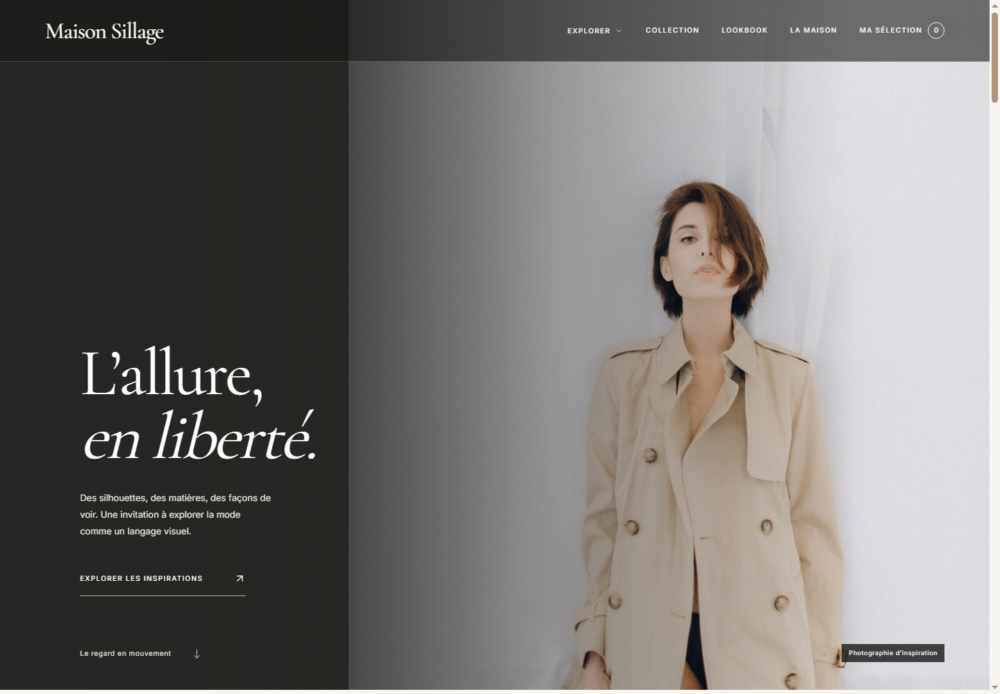

# Maison Sillage

Une vitrine de mode éditoriale en français : photographie, typographie expressive et découverte interactive des silhouettes.



## Fonctionnalités

- Accueil animé, parallaxe sur ordinateur et navigation éditoriale.
- Galerie verticale en boucle, avec pause et reprise.
- Collection filtrable et carrousel adapté au tactile et au clavier.
- Aperçu des silhouettes avec zoom.
- Lookbook interactif avec miniatures et vue agrandie.
- Favoris conservés dans le navigateur, tiroir de sélection et carnet imprimable.
- Prise en charge des petits écrans et de la réduction des animations.

Le site présente des photographies d’inspiration. Il ne propose pas encore de catalogue marchand, de commandes ou de paiement.

## Démarrer

Prérequis : Node.js **22.22 ou plus récent** et npm. Exécuter les commandes depuis la racine du dépôt.

```sh
npm ci
npm run dev --workspace web
```

Ouvrir l’adresse affichée par Vite, généralement `http://localhost:5173`.

## Vérifier et compiler

```sh
npm run typecheck
npm run build
```

Pour démarrer la version compilée :

```sh
npm run start --workspace web
```

## Structure

```text
apps/web/                 Application React Router et Vite
  app/original/           Document HTML de la page active
  app/routes/             Route qui sert ce document
  public/canva-original/  Styles, scripts, polices et photographies locales
  public/images/          Photographies complémentaires et leurs sources
  scripts/                Vérification du parcours dans un Chrome de test
packages/ui/              Composants partagés conservés dans le monorepo
```

La route d’accueil sert le document HTML exporté, enrichi par des scripts locaux et Lenis. Les pages React précédentes restent conservées. La documentation de la page active se trouve dans [DESIGN.md](apps/web/DESIGN.md) et [ANIMATIONS.md](apps/web/ANIMATIONS.md).

## Images et polices

Les photographies servent de références éditoriales et ne représentent pas des produits Maison Sillage. Les sources et les détails des variantes optimisées sont documentés dans [images/SOURCES.md](apps/web/public/images/SOURCES.md) et [optimized/SOURCES.md](apps/web/public/canva-original/optimized/SOURCES.md). La police Inter est accompagnée de sa [licence](apps/web/public/canva-original/INTER-LICENSE.txt). Les éléments tiers restent soumis à leurs conditions respectives.

## Vérification du parcours

Un test navigateur est disponible avec un Chrome isolé lancé sur le port de débogage `9334` et Vite démarré sur `5173` :

```sh
node apps/web/scripts/verify-storefront.mjs
```

Ce test manipule les favoris du profil Chrome utilisé. Ses variables de configuration et les vérifications sont décrites dans [ANIMATIONS.md](apps/web/ANIMATIONS.md). Les exports locaux et captures de test sont exclus du dépôt.
